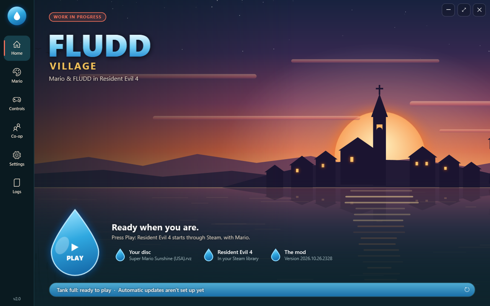
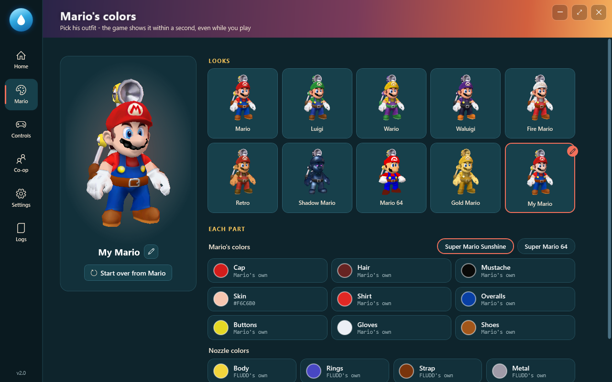
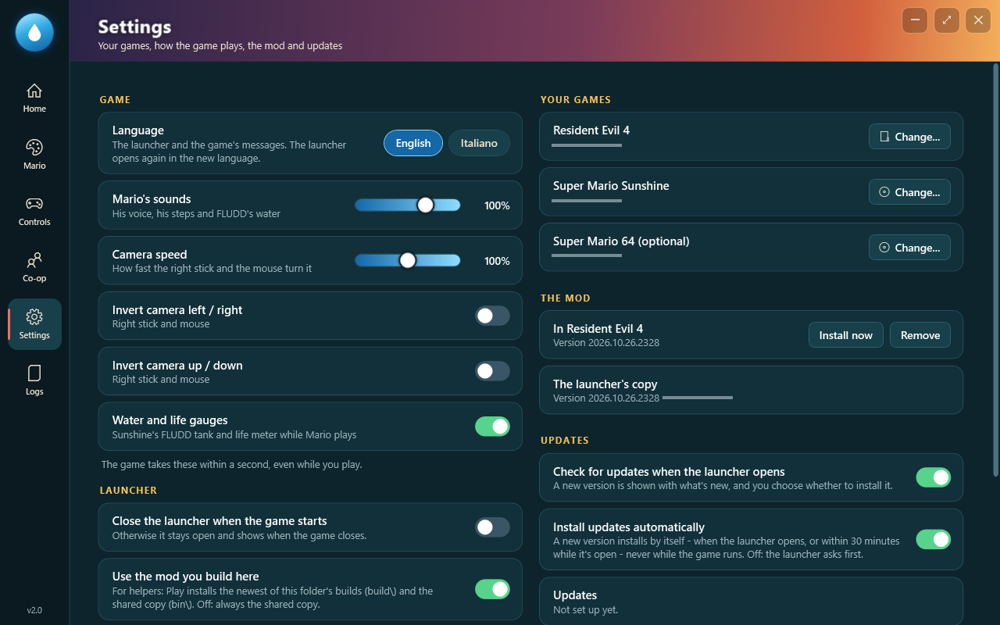
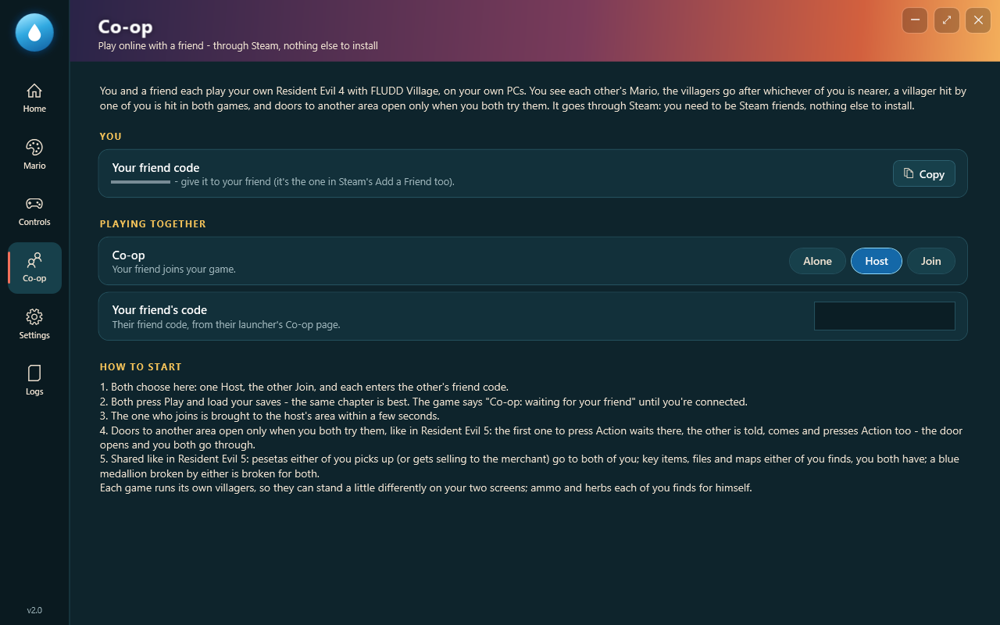
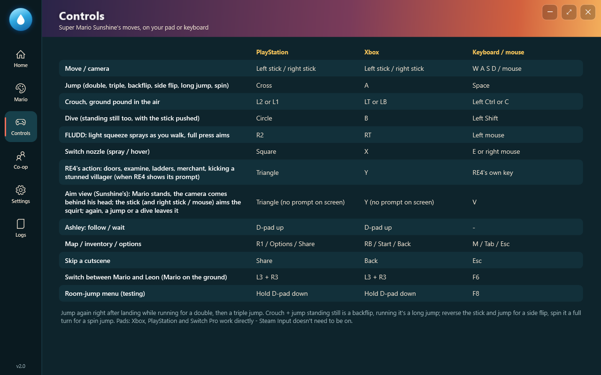

# FLUDD Village

**Play Resident Evil 4 (2005) as Mario**, with his Super Mario Sunshine moves and **FLUDD**.
No guns, no knife: you clear the village with stomps, ground pounds, dives, kicks and a water pack that hits hard but runs dry.

> [!WARNING]
> **Work in progress - not yet recommended for a full playthrough.** FLUDD Village is still being made: expect bugs,
> rough edges and parts of the game that don't work well with Mario yet (see [Known issues](#known-issues)).
> It's fine for trying it out and testing; for a whole run of Resident Evil 4, wait for a later version.
> Keep a backup of your RE4 saves if they matter to you.

### Get it: *FLUDD Village Setup.exe* is in this project's **Releases** (on the right side of this page)

> **No game files are included.** Mario's model, animations, sounds and physics are read from **your own**
> Super Mario Sunshine disc while the game runs (and Mario 64 from **your own** Super Mario 64 ROM, if you want him),
> and the mod runs inside **your own** Resident Evil 4 on Steam. This project only holds the releases: the installer,
> the launcher and the mod.

> **Made entirely with AI.** Every line of code, the launcher, the installer and this page were written by an AI
> (Claude, by Anthropic). The creator of FLUDD Village has no coding experience at all: they came up with the idea,
> played every version, reported what was wrong and decided how it should feel - the AI did the rest. EVEN THIS PAGE HAHAHA, (i'm so sorry for this ai slop)(22€..)

---

## Contents

- [In breve (italiano)](#in-breve-italiano)
- [What it is](#what-it-is)
- [What you need](#what-you-need)
- [Install](#install)
- [The launcher](#the-launcher)
- [Mario's colors](#marios-colors)
- [Settings and language](#settings-and-language)
- [Co-op (online with a friend)](#co-op-online-with-a-friend)
- [Controls](#controls)
- [Updates](#updates)
- [Uninstall](#uninstall)
- [Troubleshooting](#troubleshooting)
- [Reporting a problem](#reporting-a-problem)
- [Known issues](#known-issues)
- [Privacy](#privacy)
- [How it was made](#how-it-was-made)
- [Credits and license](#credits-and-license)

---

## In breve (italiano)

**Lavori in corso:** FLUDD Village è ancora in sviluppo e non è ancora consigliato per giocare tutto Resident Evil 4:
aspettati bug e parti del gioco che con Mario non funzionano ancora bene. Va bene per provarlo.

1. Ti servono **Resident Evil 4 (2005) su Steam** e **la tua copia di Super Mario Sunshine** (versione americana,
   GMSE01) come immagine disco: `.iso`, `.gcm`, `.nkit.iso` o `.rvz` di Dolphin. Se vuoi anche il Mario di
   Super Mario 64, serve **la tua ROM** di Super Mario 64 (USA) - è facoltativa.
2. Prendi **FLUDD Village Setup.exe** dalla sezione **Releases** di questa pagina (a destra) e aprilo. Se Windows dice
   "PC protetto da Windows": **Ulteriori informazioni → Esegui comunque** (il file non è firmato).
3. Premi **Installa**. Si apre il launcher: trova RE4 da solo, tu scegli il file del disco di Sunshine.
4. Premi **Play**. Carica un salvataggio o inizia una partita: sei Mario.

**In italiano:** il launcher e i messaggi del gioco sono anche in italiano (Impostazioni → Lingua → Italiano).

**Co-op online:** gioca con un amico, ognuno sul suo PC. Nella pagina **Co-op** del launcher uno sceglie **Host** e
l'altro **Join**, e ognuno scrive il codice amico Steam dell'altro. Passa da Steam: non serve installare altro.

Le nuove versioni si installano da sole (si può disattivare in Impostazioni → Aggiornamenti), mai mentre giochi.
Per disinstallare: Impostazioni di Windows → App → FLUDD Village → Disinstalla.

**Fatto interamente con l'AI**: il creatore non ha nessuna esperienza di programmazione.

---

## What it is

Mario takes Leon's place in Resident Evil 4. RE4's own story, enemies, doors, merchant, Ashley, cutscenes and rides
keep working around him.

- **Moves from Super Mario Sunshine:** run, single / double / triple jump, backflip, side flip, long jump, spin jump,
  ground pound, dive (even standing still) and belly slide, and the roll-out.
- **FLUDD:** the spray knocks Ganados back and wears them down; the hover nozzle keeps Mario in the air for a moment.
  The water tank empties as you use it and refills by itself when you stop for a couple of seconds.
- **Fighting without weapons:** stomp on Ganados' heads, ground-pound crowds, dive into them, spray them - and when one
  is stunned and RE4 shows its prompt, Mario kicks him.
- **Sunshine's life meter** (8 wedges): Ganado hits cost 1-3 wedges; herbs and RE4's other healing items, pesetas
  and staying out of trouble give them back. At zero Mario collapses, then RE4's own game over takes over.
- **Sunshine's water gauge** replaces RE4's HUD while you play as Mario (it can be turned off in Settings).
- **Switch back to Leon** at any moment (L3 + R3 or F6), and to Mario again.
- **Mario's colors:** Luigi, Wario, Waluigi, Fire, Retro, Shadow and Gold Mario, or your own character, each with his
  own FLUDD colors - [see below](#marios-colors). Shadow Mario is Sunshine's own, see-through dark blue glass with
  glowing eyes, like in Sunshine.
- **Mario 64:** Super Mario 64's own Mario, with his animations and **his voice** for every move, read from your own
  Super Mario 64 (USA) ROM (optional).
- **English or Italian**, for the launcher and the game's messages.
- **Single player, or online co-op for two** on two PCs, through Steam ([see below](#co-op-online-with-a-friend)).

## What you need

| | |
|---|---|
| **Windows** | Windows 10 or 11 |
| **Resident Evil 4** | *Resident Evil 4 (2005)* on Steam (not the 2023 remake) |
| **Super Mario Sunshine** | **Your own** disc image of the **North American** version (game ID **GMSE01**): `.iso`, `.gcm`, `.nkit.iso`, Dolphin's `.rvz` / `.wia`, or an extracted disc folder |
| **Super Mario 64** (optional) | **Your own** Super Mario 64 (USA) ROM (`.z64`, `.v64` or `.n64`, the original 8 MB) - only for the Mario 64 look |
| **Controller** (recommended) | Xbox / XInput pads (Xbox 360 included), PlayStation (DualSense, DualShock 4) and Switch Pro work directly - Steam Input doesn't need to be on. Keyboard and mouse work too. |
| **Internet** | To get it, for updates, and for co-op |
| **Co-op** (optional) | A friend with the same: Resident Evil 4 on Steam, their own Super Mario Sunshine disc, FLUDD Village - and you two are Steam friends |

Super Mario Sunshine discs from other regions are not supported.

## Install

1. In this project's **Releases** (on the right side of this page), open the newest version and download
   **FLUDD Village Setup.exe** (about 1 MB).
2. Open it. Because the file isn't digitally signed, Windows may show **"Windows protected your PC"**:
   click **More info → Run anyway**.
3. Press **Install**. It installs for your Windows user only, in `%LOCALAPPDATA%\Programs\FLUDD Village`
   (no administrator rights), adds Start menu and desktop shortcuts, and lists FLUDD Village in Windows' installed apps.
4. The launcher opens. It finds Resident Evil 4 in your Steam library by itself; click the
   **Super Mario Sunshine** card and pick your disc image (it checks it's GMSE01).
5. Press **Play**. The launcher puts the mod into Resident Evil 4 and starts the game through Steam.
   Load a save or start a new game: you are Mario.

Running the installer again over an older version updates it.

## The launcher

| Page | What it does |
|---|---|
| **Home** | **Play** (or click the logo): puts the mod into Resident Evil 4 (`Bin32\xinput1_3.dll`; another program's `xinput1_3.dll` already there is kept aside as `xinput1_3.dll.before-fludd`), starts the game through Steam and shows **Running** until you close it. Three drops show what's ready: **your disc**, **Resident Evil 4** and **the mod**. The water tank at the bottom shows the update status (↻ checks now). |
| **Mario** | Mario's colors and looks, Mario 64 included, with Mario in 3D ([see below](#marios-colors)). |
| **Controls** | Every control, for PlayStation, Xbox and keyboard. |
| **Co-op** | Play online with a friend ([see below](#co-op-online-with-a-friend)). |
| **Settings** | The language, how the game plays, your games, the mod and updates ([see below](#settings-and-language)). |
| **Logs** | What the launcher did, and what the mod wrote during your last game - copy or save them to report a problem. |

The window can be made bigger, or full screen with **F11** (Esc goes back).

## Mario's colors

Pick one of the looks - **Mario, Luigi, Wario, Waluigi, Fire Mario, Retro, Shadow Mario, Mario 64, Gold Mario** - or
**edit your own character**: name it, choose Super Mario Sunshine's or Super Mario 64's Mario, and pick the cap, hair,
mustache, skin, shirt, overalls, buttons, gloves and shoes one by one. **FLUDD's colors** (body, rings, strap, metal)
can be changed on any look. The game changes Mario within a second, even while you play.

**Shadow Mario** is Sunshine's own model, drawn like in Sunshine: dark blue glass that shows the place behind him,
with glowing pink eyes. **Mario 64** needs your Super Mario 64 ROM: without it his tile shows a padlock and a button
to choose the ROM.

## Settings and language

- **Language:** English or Italiano - the launcher and the game's messages.
- **The game:** Mario's sounds' volume, camera speed, camera left / right and up / down inverted, Sunshine's water and
  life gauges on or off. The game takes these within a second, even while you play.
- **Your games:** Resident Evil 4, your Super Mario Sunshine disc and (optional) your Super Mario 64 ROM.
- **The mod:** install it into Resident Evil 4 now, or take it out.
- **Updates:** check when the launcher opens, install automatically ([see below](#updates)).

## Co-op (online with a friend)

You and a friend each play your own Resident Evil 4 with FLUDD Village, on your own PCs, and see each other's Mario.
It goes through **Steam's own connection between friends**: nothing else to install, no router settings, and your
game only listens to the one friend you named.

1. Be **Steam friends**, and both have the newest FLUDD Village.
2. In the launcher's **Co-op** page, one picks **Host** and the other **Join**. Each types the **other's friend code**
   (shown on their Co-op page, with a Copy button - it's the same number as in Steam's *Add a Friend*).
3. Both press **Play** and load a save - the same chapter is best. The game says *"Co-op: waiting for your friend"*
   until you're connected.
4. Whoever joins is brought to the host's area within a few seconds.

Shared like in Resident Evil 5: the villagers go after whichever of you is nearer, and a villager hit by one of you is
hit in both games. **Doors to another area open only when you both try them**: the first one waits there, the other is
told and comes. **Pesetas** either of you picks up go to both of you; **key items, files and maps** either of you
finds, you both have; a **blue medallion** broken by either is broken for both. Ammo and herbs each of you finds for
himself. To play alone again, pick **Alone**.

## Controls

| Action | PlayStation | Xbox | Keyboard / mouse |
|---|---|---|---|
| Move / camera | Left stick / right stick | Left stick / right stick | W A S D / mouse |
| Jump (double, triple, backflip, side flip, long jump, spin) | Cross | A | Space |
| Crouch, ground pound in the air | L2 or L1 | LT or LB | Left Ctrl or C |
| Dive (standing still too, with the stick pushed) | Circle | B | Left Shift |
| FLUDD (light squeeze: spray as you walk; full press: plant and aim) | R2 | RT | Left mouse |
| Switch nozzle (spray / hover) | Square | X | E or right mouse |
| RE4's action: doors, examine, ladders, merchant, kicking a stunned villager | Triangle | Y | RE4's own key |
| Aim view (Sunshine's): the camera behind Mario's head, the stick aims the squirt | Triangle (no prompt on screen) | Y (no prompt on screen) | V |
| Ashley: follow / wait | D-pad up | D-pad up | - |
| Map / inventory / options | R1 / Options / Share | RB / Start / Back | M / Tab / Esc |
| Skip a cutscene | Share | Back | Esc |
| Switch between Mario and Leon | L3 + R3 | L3 + R3 | F6 |
| Room-jump menu (testing) | Hold D-pad down | Hold D-pad down | F8 |

**Tips (as in Sunshine):** jump again right after landing while running for a double, then a triple jump.
Crouch + jump standing still is a backflip; while running it's a long jump. Reverse the stick while running and jump
for a side flip; spin the stick a full turn and jump for a spin jump.

The **room-jump menu** is for testing: it skips the story, so a room from a later chapter can be empty or its events
can break. To play normally, load a save instead.

## Updates

- **Updates install by themselves.** The launcher checks this project's latest release when it opens, and again
  every 30 minutes while it stays open. A new version installs on its own - never while Resident Evil 4 is running
  (it waits until the game closes) - and once it runs, a **What's new** screen shows everything that changed.
- Settings → Updates: **Check for updates when the launcher opens** (on) and **Install updates automatically** (on).
  With automatic installs off, the launcher shows **A new version is here** with the list of what's new, and you
  choose: **Update now**, **Not now** or **Skip this version** (the update button in the water tank opens it again).
- An update replaces only the launcher's own files. The download is checked against its SHA-256 before anything
  changes, temporary files are deleted afterwards, and nothing is left behind. Your disc, your ROM, your settings and
  your RE4 saves are never touched. The new mod goes into Resident Evil 4 the next time you press Play.

Every version and its notes are in this project's **Releases**.

## Uninstall

**Windows Settings → Apps → Installed apps → FLUDD Village → Uninstall.** You choose whether to also take the mod out
of Resident Evil 4 (any `xinput1_3.dll` that was there before is put back). Your settings and logs stay in
`%LOCALAPPDATA%\FluddVillage`; delete that folder to remove them too.

To take the mod out of the game by hand: delete `Resident Evil 4\Bin32\xinput1_3.dll` (and rename
`xinput1_3.dll.before-fludd` back to `xinput1_3.dll` if it's there).

## Troubleshooting

| Problem | What to do |
|---|---|
| **"Windows protected your PC"** when opening the installer | The file isn't digitally signed (that needs a paid certificate): **More info → Run anyway**. |
| **You play as Leon, not Mario** | Look at the Super Mario Sunshine card: if it isn't ✓, pick your disc again (it must be GMSE01). Or Mario was switched off: press **L3 + R3** (or **F6**). |
| **Mario 64 has a padlock** | Settings → Your games → Super Mario 64: choose your ROM (the USA one, 8 MB). |
| **Play doesn't start the game** | Steam has to be running and signed in, with Resident Evil 4 installed. The activity log says what happened. |
| **The mod in RE4 is an old one** | Settings → The mod → **Install now** (Resident Evil 4 must be closed). |
| **Your antivirus complains about xinput1_3.dll** | The mod loads into the game as `xinput1_3.dll` (a common way for game mods to run); some antivirus programs are wary of that. It's the file from this project's releases. |
| **Co-op: "waiting for your friend" never ends** | Both of you: Steam running and signed in, Steam friends, the newest FLUDD Village, one on **Host** and one on **Join**, and each with the **other's** friend code. Change the Co-op page before pressing Play (the game reads it when it starts). |
| **Co-op: "your friend has another version of the mod"** | Both update (the launcher does it by itself when it opens), then start again. |

## Reporting a problem

In the launcher, open **Logs** and copy or save the game's log, and send it with what
happened, where (which room or part of the game) and roughly when. A short video helps a lot. The logs are in
`%LOCALAPPDATA%\FluddVillage` (`mod.log` is started fresh every time the game starts, so copy it before playing again).

## Known issues

FLUDD Village is a **work in progress**: not every part of Resident Evil 4 has been played through with Mario yet, so
some rooms, events, bosses and rides may not work well. What's known so far:

- **Co-op:** each game runs its own villagers, so they can stand a little differently on your two screens.
- Mario can't push RE4's movable objects yet.
- Only the North American Super Mario Sunshine disc (GMSE01) and the USA Super Mario 64 ROM are supported.
- Resident Evil 4 (2005) on Steam only.

## Privacy

- **Nothing about you is sent anywhere.** The launcher's only internet use is downloading this project's
  `latest.txt` to check for updates (and the update itself). No accounts, no tracking.
- **Co-op** (off unless you pick Host or Join): while you play, your game sends the one friend you named - through
  Steam, to nobody else - where your Mario is, his animation and colors, your hits on villagers and what you share
  (doors, pesetas, items). Nothing else. The launcher reads your own friend code from Steam on your PC to show it to
  you; it isn't sent anywhere.
- Your Super Mario Sunshine disc and Super Mario 64 ROM never leave your PC: the mod reads what Mario needs from them
  while you play, and writes none of it anywhere.

## How it was made

FLUDD Village was made **entirely with AI**: Claude (Anthropic) wrote everything - the mod that puts Mario into
Resident Evil 4 (his physics, animations, sounds, collision with RE4's world, FLUDD's water, the enemies' hit boxes,
the camera, Mario's colors, Mario 64, the online co-op), the reader for Super Mario Sunshine's disc formats, the
launcher, the installer, the update system and this page.

The creator has **no experience with coding or modding**. Their part was the idea, the design ("how should this
feel?"), and a lot of playtesting: every bug fixed here started as a report like *"Mario gets stuck in this wall"*
or *"the controller doesn't work in the menu"*.

## Credits and license

- Made with AI (Claude, by Anthropic) for its creator.
- Resident Evil 4 structure offsets from the public research in
  [re4_tweaks](https://github.com/nipkownix/re4_tweaks) (nipkownix and contributors).
- Super Mario Sunshine file formats documented by the GameCube modding community; its behaviour studied from the
  [doldecomp/sms](https://github.com/doldecomp/sms) decompilation (no code taken).
- Super Mario 64's formats, sounds and Mario's actions studied from the
  [n64decomp/sm64](https://github.com/n64decomp/sm64) decompilation.
- [Zstandard](https://github.com/facebook/zstd) (Meta, BSD license) reads Dolphin's `.rvz` discs - see
  [THIRD-PARTY-NOTICES.txt](THIRD-PARTY-NOTICES.txt).
- FLUDD Village is under the [MIT License](LICENSE).

*Unofficial fan project, not affiliated with or endorsed by Nintendo or Capcom. Super Mario Sunshine and Super Mario 64
are © Nintendo. Resident Evil 4 is © Capcom.*
